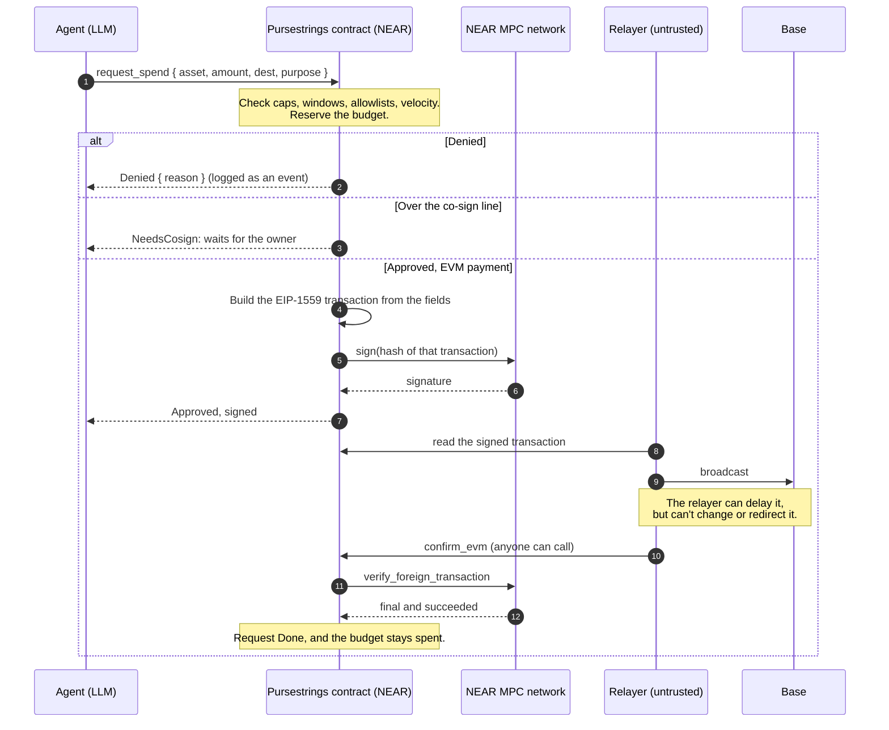
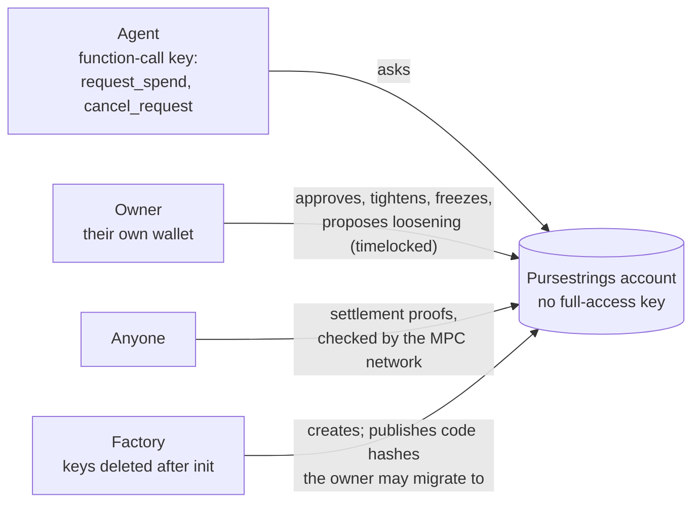
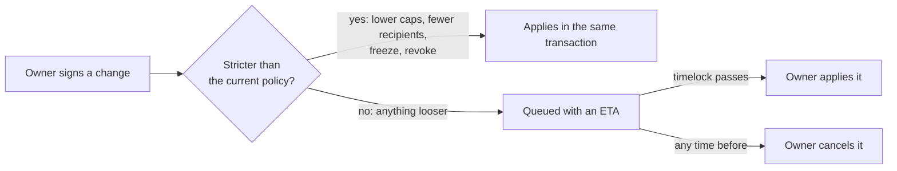

# Pursestrings

One spending policy for an AI agent across every chain. Jailbreak the agent and the money still doesn't move.

· [pursestrings.site](https://pursestrings.site) · [The Range](https://pursestrings.site/range) · [Dashboard](https://pursestrings.site/app) · [Threat model](THREAT_MODEL.md)

## The problem

An agent that holds a wallet key can spend everything that key reaches. Prompt injection, a poisoned
tool result or a runaway loop all look like the agent's own decisions, and a system prompt is not a
limit. Making a human approve every payment fixes that, but then the agent isn't autonomous.

## What Pursestrings does

The agent gets no key that can move money. It gets a NEAR access key that can only call
`request_spend` on its Pursestrings account, a contract the owner controls. The contract checks
each request against the owner's policy and pays it itself:

- **On NEAR**, as a native or NEP-141 transfer ([spend.rs](contracts/pursestrings/src/spend.rs#L165)).
- **On any EVM chain**, by building the EIP-1559 transaction from typed fields
  ([evm.rs:99](contracts/pursestrings/src/evm.rs#L99)) and having NEAR's MPC network sign it for
  the account's own derived address through Chain Signatures
  ([evm.rs:354](contracts/pursestrings/src/evm.rs#L354)).
- **Through NEAR Intents**, with transfers and withdrawals called directly on `intents.near` and
  swaps signed as a `token_diff` the contract wrote itself
  ([intents.rs:128](contracts/pursestrings/src/intents.rs#L128)).

The policy has per-payment caps, rolling windows per asset, budget groups that share one window
across chains ([policy.rs:48](contracts/pursestrings/src/policy.rs#L48)), recipient and chain
allowlists, a co-sign line, minimum swap rates, a velocity limit and a fee budget. Making the
policy stricter applies at once. Making it looser waits out a timelock. Every request, decision
and execution is a NEP-297 event ([events.rs](contracts/pursestrings/src/events.rs#L8)).

The seven security invariants, where each is enforced and the test that checks it, are in
[THREAT_MODEL.md](THREAT_MODEL.md).

### How a payment flows

The agent sends structured fields. Everything that gets signed is built inside the contract.

### Who can do what

### Changing the rules

## Try it: do X, see Y

You need `cargo` (rustup reads [rust-toolchain.toml](rust-toolchain.toml)), Node 22+ and pnpm 10.
No keys, accounts or network access to NEAR are needed: everything runs on a local sandbox.

| Do | See |
|---|---|
| `make demo` | A local chain at mainnet's protocol version with the factory, a keyless account, the mainnet `intents.near` wasm, test tokens and a mock MPC signer. The demo agent pays a NEAR service, pays a Base merchant (the signed transaction's sender recovers to the account's own address) and swaps through Intents from one $150/day budget, then runs six attacks, a co-sign and the kill switch. It ends with `demo OK: 22/22 checks passed` ([demo.ts](apps/agent/src/demo.ts)). |
| `make redteam` | Six attacks with the same output every run, compared against [expected.txt](scripts/redteam/expected.txt) ([redteam.ts](apps/agent/src/redteam.ts)). |
| `make test` | Contract unit tests, sandbox tests for every invariant, and the TypeScript tests. |
| `make demo-keep` | The same demo, with the local chain left running afterwards. |
| Open [pursestrings.site/range](https://pursestrings.site/range) | A deliberately gullible agent guarding a testnet account. Talk it into anything; the contract decides. |
| Open [pursestrings.site/app](https://pursestrings.site/app) | The testnet Range account's policy, budgets, timelock queue and payments, read live from the chain. |

## Pieces

| Path | What it is |
|---|---|
| [contracts/pursestrings](contracts/pursestrings) | The policy contract (near-sdk 5.29) |
| [contracts/factory](contracts/factory) | Creates accounts with no access keys and publishes the code hashes they may migrate to |
| [packages/sdk](packages/sdk) | TypeScript SDK: agent, owner and anyone calls, views, signed-transaction decoding |
| [packages/mcp](packages/mcp/src/server.ts) | MCP server for any agent: `request_spend`, `budget_status`, `explain_denial`, `spending_policy`, `request_status`. Runs with the agent key only |
| [services/relayer](services/relayer/src/relayer.ts) | Broadcasts signed EVM transactions and swaps, and submits settlement proofs. Holds no keys that matter: it can delay a payment but can't change one |
| [apps/agent](apps/agent/src) | The scripted demo agent and the red-team suite |
| [apps/range](apps/range/src) | The Range backend: an LLM agent (Claude Haiku 5.5 on NEAR AI Cloud) on the MCP tools, NEP-413 sign-in, per-account rate limits and a daily model-cost cap |
| [apps/web](apps/web/src) | pursestrings.site: landing page, the Range and the owner dashboard |

## NEAR technology used

- **Function-call access keys** with a gas allowance: the agent's key is limited by the protocol to
  two methods on one account ([admin.rs:28](contracts/pursestrings/src/admin.rs#L28)).
- **Chain Signatures**: `sign` in ECDSA mode for EVM transactions and EdDSA mode for intents,
  `derived_public_key` for the account's Intents key
  ([intents.rs:176](contracts/pursestrings/src/intents.rs#L176)), and `verify_foreign_transaction`
  so the contract learns that a Base payment is final and succeeded without trusting anyone
  ([evm.rs:203](contracts/pursestrings/src/evm.rs#L203)).
- **NEAR Intents**: `add_public_key`, `mt_transfer`, `ft_withdraw`, signed `raw_ed25519` swaps with
  versioned nonces, and `is_nonce_used` for settlement. Tested against the mainnet `intents.near`
  v0.4.5 wasm ([tests/intents.rs](contracts/pursestrings/tests/intents.rs)).
- **Sub-accounts from a factory**: `<name>.<factory>` with no access keys at all
  ([factory lib.rs:80](contracts/factory/src/lib.rs#L80)).
- **NEP-297 events, NEP-141 tokens, NEP-413 signed messages** (Range sign-in).
- **NEAR AI Cloud** for the Range agent's model.

## Why only on NEAR

- A NEAR access key can be limited by the protocol to specific methods on one contract, with a gas
  allowance. The agent's key isn't trusted to behave; it can't do anything else.
- A NEAR contract controls addresses on other chains through Chain Signatures, so one contract can
  hold the policy for NEAR, Base and any other EVM chain, and sign only what it built.
- The same contract is an identity on NEAR Intents, so swaps and cross-chain withdrawals go through
  the same policy.
- The MPC network can attest that a foreign transaction is final and succeeded, so the policy's
  books close on-chain without an oracle or a trusted relayer.

## Compared to other approaches

| | Agent holds a wallet key | Policy enforced by a hosted wallet service | Smart-account session keys | Pursestrings |
|---|---|---|---|---|
| Where limits are enforced | Nowhere | The vendor's servers or MPC nodes | A contract on one chain | A public contract on NEAR |
| Chains covered | One per key | Whatever the vendor supports | That chain | NEAR, EVM chains through Chain Signatures, NEAR Intents |
| What a compromised agent can sign | Anything | What the vendor's policy allows | What the session key allows | Nothing: the contract builds every payload |
| Who you trust | Nobody can stop the key | The vendor | The account's code | The contract's code and NEAR's MPC network |
| Changing the rules | Not applicable | The vendor's admin tools | Owner transaction | Owner transaction; loosening is time-locked |

## Verify it yourself

Testnet. Every NEAR transaction opens on [nearblocks](https://testnet.nearblocks.io); EVM ones on
[Base Sepolia's explorer](https://sepolia.basescan.org).

| Claim | Where to look |
|---|---|
| The Range account has no access keys except the agent's function-call key | [range.factory.ps-spike-1028.testnet](https://testnet.nearblocks.io/address/range.factory.ps-spike-1028.testnet), access keys tab |
| A fooled agent's payment to an attacker is refused and recorded | [`C7KyrKfs…`](https://testnet.nearblocks.io/txns/C7KyrKfsHrUHKd4ZesuEk7dJQpjN8K3D3sbYukvdeHXu): `spend_requested` event, `Denied { RecipientNotAllowed }` |
| A Base payment built and signed by the contract settles | Request [`Eq88EDmC…`](https://testnet.nearblocks.io/txns/Eq88EDmCPredJZYt8bq4Y9W3vJujwLc4Yis29Nqx9j5d), Base Sepolia [`0x0d5615a2…3e73`](https://sepolia.basescan.org/tx/0x0d5615a263515af48ff4aca3eef4ffbca84cc7519297c5f9cbc074efc1213e73) |
| A third party proves that Base payment final through the MPC network | [`E9Npn91h…`](https://testnet.nearblocks.io/txns/E9Npn91hN8RezZhamw41tg7BRtdEEW7ztM5svCvZec9W): `confirm_evm(0)` by another account; the contract asks `verify_foreign_transaction` and marks the request `Done` |
| Red-team case 6: a legitimate 40 USDC to the Base merchant, end to end | Request [`6tZx8ojH…`](https://testnet.nearblocks.io/txns/6tZx8ojHjogyKUbBgH2j2ZYbQmvZL85DvRna29JR9Y8J), Base Sepolia [`0x0b9ca7be…7bbb`](https://sepolia.basescan.org/tx/0x0b9ca7be8ab0133f35d05326086129364ac5a3f46e8ba51e22209567f19b7bbb), proven final by a third party in [`6to9rRaQ…`](https://testnet.nearblocks.io/txns/6to9rRaQ76mQENKhWAqAZFxPBHYEQCUSYp99Zm7rnqNv) |
| Code changes only to a factory-published hash, after the timelock | Publish [`A4mcn6No…`](https://testnet.nearblocks.io/txns/A4mcn6No1wbvqRXwwcPMQXnUzianv97yHZH5GpRqXV9c), propose [`HnLFxKy2…`](https://testnet.nearblocks.io/txns/HnLFxKy2HuoQwUP4gsc4MpGrFGQ4mJmyB8kB7G3C7MJo), apply an hour later [`3DepsqBc…`](https://testnet.nearblocks.io/txns/3DepsqBcV3ckGu9LVgAeHS2KAoucmLDYRPcY21MD6UhT) |

## Costs

On testnet the Range account uses 443,759 bytes of storage, about 4.4 NEAR of storage stake, almost
all of it the 439 KB contract. Gas for each request comes out of the agent key's allowance (1 NEAR
on the Range account), and deposits the contract attaches, such as MPC signing fees, come out of the
policy's fee budget, so a compromised agent can't drain NEAR through fees
([`fee_budget_caps_contract_paid_deposits`](contracts/pursestrings/src/spend.rs#L622),
[`evm_gas_budget_stops_fee_spam`](contracts/pursestrings/tests/evm.rs#L311)).
Mainnet costs will be measured and listed here.

## Sustainability

The people who pay are agent platforms and businesses that run agents with money. Pricing would be
a per-account subscription or a small fee on governed volume. Nothing
in the payment path needs a server of ours: the relayer is replaceable, and settlement proofs can
be submitted by anyone.

## Limitations

- **No risk screener.** Invariant 5 isn't built. A rule's risk threshold sends the request to the
  owner's co-sign instead.
- **No USD budgets.** Budgets are in each asset's own units. A budget group joins assets the owner
  declares to be the same unit (USDC on NEAR, Base and Intents); there's no price oracle.
- **Intents has no testnet.** The Intents paths are tested in the sandbox against the mainnet
  `intents.near` wasm. A live mainnet swap needs the solver relay and hasn't run yet.
- **The relayer can delay.** It can't redirect or change a payment, but a signed EVM transaction
  keeps its budget reserved until it's proven settled or replaced.
- **Finality lag.** The MPC network confirms a Base Sepolia payment several minutes to half an
  hour after the public `finalized` head passes it.
- **The owner key is powerful.** A stolen owner key can't loosen the policy quickly, but it can
  approve pending co-signs and withdraw to the owner account.
- **Reverted EVM transactions** and chains the MPC network can't verify fall back to the owner's
  word (`resolve_evm`).

## License

[Apache-2.0](LICENSE)
